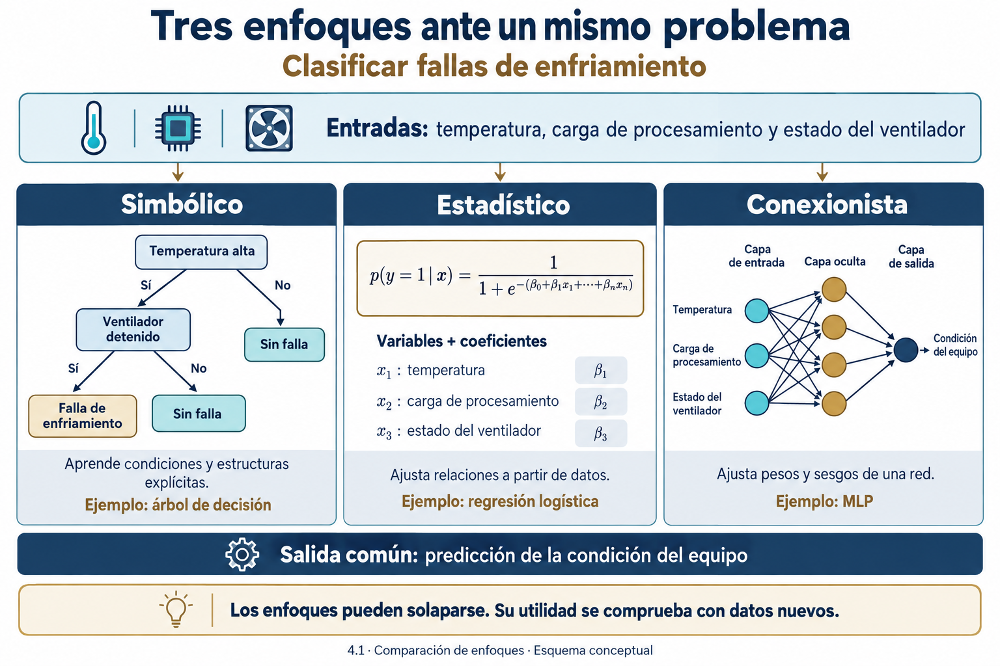
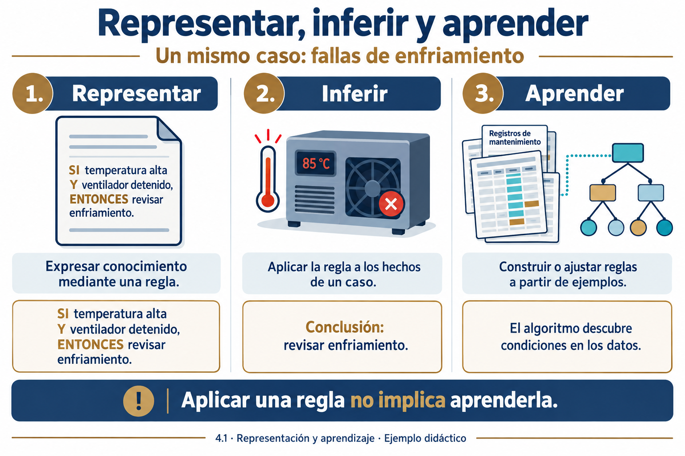
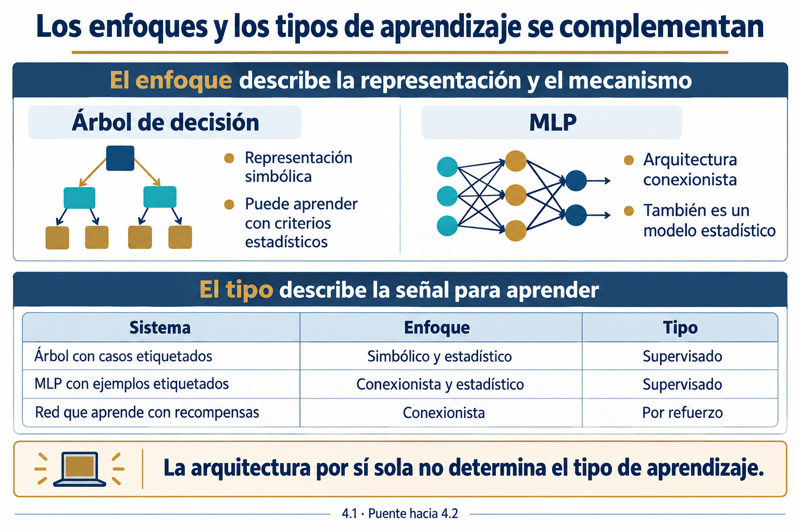

# 4.1 Diferencia entre aprendizaje simbólico, estadístico y conexionista

## Propósito

Comparar el aprendizaje simbólico, estadístico y conexionista a partir de la representación del conocimiento, el proceso de aprendizaje y la forma de producir respuestas. La comparación permitirá justificar alternativas para un problema de ingeniería sin asumir que los enfoques son mutuamente excluyentes.

## Resultados de aprendizaje

Al concluir el subtema, el estudiante podrá:

1. Diferenciar la aplicación de conocimiento de su adquisición mediante aprendizaje.
2. Explicar qué aprende y cómo representa lo aprendido cada enfoque.
3. Analizar un problema común mediante reglas aprendidas, un modelo estadístico y una red neuronal.
4. Reconocer solapamientos y distinguir estos enfoques de los tipos de aprendizaje supervisado, no supervisado y por refuerzo.
5. Proponer criterios para comparar soluciones con datos nuevos.
6. Reconocer los principales retos de los datos y distinguir sobreajuste de subajuste.

## Ruta de estudio

Recupere primero los conceptos de reglas e inferencia de la Unidad 3. Lea después los tres enfoques y el caso resuelto. Utilice la tabla comparativa para elaborar la actividad y responda las preguntas de autoevaluación antes de consultar las respuestas orientadoras.

Este apunte desarrolla los fundamentos conceptuales. Los algoritmos se implementarán en 4.3 y 4.4, y la evaluación experimental se profundizará en 4.5. La clasificación según la señal de aprendizaje, la actualización por lotes u online y la generalización por instancias o modelos corresponde a 4.2.

## 1. Problema de partida

Un equipo de desarrollo debe construir un sistema para identificar fallas de enfriamiento en equipos de cómputo. Cuenta con registros de temperatura, carga de procesamiento, funcionamiento del ventilador y diagnósticos emitidos después de una revisión técnica.

El equipo podría escribir reglas a partir de la experiencia de un especialista, aprender un árbol de decisión con los registros, ajustar una regresión logística o entrenar una red neuronal. Todas las alternativas pueden producir una clasificación, pero construyen y representan la solución de distinta manera.

**Pregunta orientadora:** si varias soluciones entregan la misma categoría, ¿cómo podemos reconocer sus diferencias y comprobar cuál resulta adecuada para el problema?

## 2. De la representación del conocimiento al aprendizaje

En la Unidad 3 estudiamos sistemas que representan conocimiento y realizan inferencias. Por ejemplo, una base de conocimiento puede contener la regla:

> Si la temperatura supera el límite de operación y el ventilador está detenido, entonces se requiere revisar el sistema de enfriamiento.

Cuando el sistema recibe hechos que satisfacen las condiciones, obtiene una conclusión. Esta operación es una inferencia. Aplicar la regla repetidamente no modifica necesariamente la base de conocimiento.

El aprendizaje aparece cuando un procedimiento utiliza experiencia para construir o ajustar una representación que ayuda a resolver una tarea. En el ejemplo anterior, un algoritmo podría descubrir condiciones para detectar fallas a partir de casos históricos. También podría ajustar parámetros numéricos para relacionar mediciones y diagnósticos [1, cap. 1; 2, cap. 8].

| Operación | Qué ocurre | Ejemplo |
|---|---|---|
| Representar | Se expresa conocimiento en una estructura. | Registrar una regla sobre temperatura y ventilación. |
| Inferir o predecir | Se utiliza el conocimiento disponible para obtener una respuesta. | Aplicar la regla a un equipo que presenta esas condiciones. |
| Aprender | Se construye o modifica una representación con datos o experiencia. | Inducir la regla o ajustar sus condiciones con registros históricos. |

Estas operaciones pueden coexistir. Un sistema aprende durante el entrenamiento y después utiliza lo aprendido para responder a nuevas entradas. También puede incorporar conocimiento previo que no proviene de los datos.

### 2.1 Experiencia, tarea y evaluación

Para describir un problema de aprendizaje necesitamos identificar la tarea, los datos o experiencia disponibles y el criterio de desempeño. En nuestro caso, la tarea es clasificar condiciones de operación, la experiencia son los registros diagnosticados y la evaluación compara las predicciones con diagnósticos de referencia en casos nuevos.

Géron explica la generalización como la capacidad de funcionar con ejemplos no utilizados para entrenar. Por eso, ajustar muy bien los datos conocidos no basta para demostrar utilidad [1, cap. 1].

**Comentario del profesor.** Un sistema que memoriza identificadores de equipos podría acertar en los registros conocidos sin aprender una relación útil entre mediciones y fallas. La evaluación debe corresponder a las condiciones futuras de uso.



*Figura 1. Representar, inferir y aprender en un caso de fallas de enfriamiento. Elaboración didáctica con apoyo de IA, basada en los conceptos de [1] y [2].*

## 3. Aprendizaje simbólico

### 3.1 Idea central

El aprendizaje simbólico construye conocimiento mediante estructuras explícitas, como reglas, árboles de decisión o expresiones lógicas. Sus componentes pueden interpretarse en términos del dominio: una condición representa una propiedad y una regla vincula condiciones con conclusiones.

La característica distintiva es la representación aprendida. La adquisición puede realizarse mediante búsqueda, inducción o procedimientos que también utilizan criterios estadísticos. En consecuencia, una representación simbólica no implica ausencia de estadística [2, sec. 8.4].

### 3.2 Cómo aprende

Un algoritmo recibe ejemplos y, en algunos métodos, conocimiento de fondo. Explora estructuras candidatas, evalúa qué tan bien explican los ejemplos y selecciona una representación según sus criterios de aprendizaje. Puede preferir estructuras sencillas o penalizar complejidad para favorecer la generalización.

En un árbol de decisión, cada nodo interno pregunta por una característica, cada rama corresponde a una respuesta y cada hoja produce una predicción. Las rutas pueden expresarse como reglas. Los algoritmos habituales eligen divisiones que mejoran un criterio como la reducción de impureza [1, cap. 6].

### 3.3 Ejemplo

A partir de registros de mantenimiento, un algoritmo podría construir esta regla hipotética:

```text
SI temperatura_alta = verdadero
Y ventilador_detenido = verdadero
ENTONCES clase = falla_de_enfriamiento
```

La regla es una hipótesis derivada de los ejemplos. No garantiza una relación universal ni sustituye una comprobación técnica. Es posible que un sensor registre incorrectamente el estado del ventilador o que una falla produzca un patrón distinto.

Si una persona escribió la regla y el sistema únicamente la ejecuta, hablamos de un sistema simbólico, pero no hemos descrito un proceso de aprendizaje. Si el algoritmo obtiene la regla a partir de registros, sí existe aprendizaje simbólico.

### 3.4 Ventajas y limitaciones

Una regla breve o un árbol pequeño permiten inspeccionar las condiciones que conducen a una respuesta. Esto facilita la discusión con especialistas, la revisión de contradicciones y la documentación.

Sin embargo, la interpretabilidad disminuye cuando la estructura crece. Un árbol profundo puede memorizar particularidades y una colección extensa de reglas puede ser difícil de revisar. Además, representar imágenes o audio mediante condiciones simbólicas útiles suele requerir transformar previamente los datos.

**Ejemplos de métodos:** inducción de reglas, aprendizaje de árboles y programación lógica inductiva. Esta última aprende expresiones lógicas utilizando ejemplos y conocimiento de fondo. Su estudio detallado queda fuera del alcance de esta unidad.

## 4. Aprendizaje estadístico

### 4.1 Idea central

El aprendizaje estadístico estudia cómo construir modelos a partir de datos y cómo evaluar su capacidad de generalización. Un procedimiento selecciona una representación o familia de funciones y utiliza los datos para ajustar sus parámetros o estructura.

La explicación introductoria puede centrarse en modelos paramétricos, pero el campo también incluye métodos no paramétricos, como k-NN. Por tanto, el enfoque no se limita a aprender unos cuantos coeficientes [1, caps. 1 y 4].

Habitualmente se distinguen entradas, salidas, parámetros, una función de pérdida y un procedimiento de ajuste. Los supuestos del modelo determinan qué relaciones puede representar y qué información necesita.

### 4.2 Un ejemplo con regresión logística

Supongamos que queremos clasificar una condición como falla o funcionamiento normal. Una regresión logística puede combinar características numéricas para estimar la probabilidad de falla:

\[
z=b+w_1x_1+w_2x_2+w_3x_3
\]

\[
\hat{p}=\sigma(z)=\frac{1}{1+e^{-z}}
\]

Aquí, \(x_1\), \(x_2\) y \(x_3\) son características, \(w_1\), \(w_2\) y \(w_3\) son pesos, y \(b\) es un término independiente. El entrenamiento ajusta estos parámetros. La función logística transforma el resultado en un valor entre cero y uno [1, cap. 4].

Para ilustrar el cálculo, utilizaremos variables binarias y coeficientes **inventados con finalidad didáctica**:

- \(x_1=1\) si la temperatura está por encima del límite de referencia.
- \(x_2=1\) si el ventilador está detenido.
- \(x_3=1\) si la carga de procesamiento es alta.
- \(b=-2\), \(w_1=1.5\), \(w_2=2\) y \(w_3=0.5\).

Para \(x=(1,1,0)\):

\[
z=-2+1.5+2=1.5, \qquad \hat{p}\approx0.818.
\]

Con un umbral de 0.5, la salida sería la clase «falla». El cálculo muestra cómo se aplica un modelo; **no demuestra que esos coeficientes sean adecuados**, porque no proceden de un experimento. En una aplicación real deben aprenderse con datos y evaluarse.

El valor 0.818 es una probabilidad estimada bajo el modelo. No representa certeza ni demuestra que sus probabilidades estén bien calibradas. El umbral también debe elegirse considerando las consecuencias de los errores.

### 4.3 Diversidad de modelos

En esta unidad estudiaremos regresión logística, Naive Bayes y SVM. Naive Bayes utiliza un modelo probabilístico con un supuesto de independencia condicional entre características dada la clase. SVM aprende una función de decisión que busca separar categorías considerando un margen.

No todos los métodos estadísticos entregan probabilidades de forma directa. Una SVM estándar produce valores de decisión; obtener probabilidades exige procedimientos adicionales. Tampoco todos los modelos estadísticos son lineales [1, caps. 4 y 5; 3, caps. 3 y 4].

### 4.4 Ventajas y limitaciones

El enfoque permite relacionar el ajuste con criterios explícitos de error y estudiar regularización, incertidumbre y generalización. Sin embargo, un procedimiento matemático correcto puede producir resultados poco útiles si los datos no representan el contexto de uso o si las características contienen información que no estará disponible al predecir.

La interpretación depende del modelo. Incluso los coeficientes de una regresión requieren considerar escalas, codificación y relaciones entre variables. Una asociación aprendida no establece por sí sola causalidad.

## 5. Aprendizaje conexionista

### 5.1 Idea central

El conexionismo utiliza redes de unidades de procesamiento conectadas. El conocimiento queda distribuido en los parámetros de la red, y las activaciones intermedias representan transformaciones de la entrada al procesar un ejemplo.

Una unidad puede calcular una combinación ponderada de entradas y aplicar una función de activación:

\[
a=\phi\left(b+\sum_{j=1}^{d}w_jx_j\right).
\]

Los pesos \(w_j\) determinan la contribución de las entradas, \(b\) desplaza la combinación y \(\phi\) transforma el resultado. Estas unidades son simplificaciones computacionales con inspiración biológica; no reproducen fielmente las neuronas del cerebro [1, cap. 10].

### 5.2 Perceptrón multicapa

Un perceptrón multicapa o **MLP** organiza unidades en una capa de entrada, una o más capas ocultas y una capa de salida. Las capas ocultas transforman los datos y permiten construir representaciones intermedias.

Las activaciones no lineales resultan esenciales: una composición de transformaciones afines sin activaciones no lineales sigue siendo equivalente a una transformación afín. Agregar capas de ese tipo no aporta por sí solo la capacidad de representar relaciones no lineales.

Un MLP puede recibir las mismas variables del ejemplo anterior. Su arquitectura y entrenamiento permiten aprender interacciones entre ellas sin tener que escribir una regla para cada combinación.

### 5.3 Cómo aprende

Durante un entrenamiento supervisado, la red produce predicciones y una función de pérdida cuantifica su diferencia respecto a los valores esperados. La retropropagación calcula gradientes de esa pérdida respecto a los parámetros. Un optimizador utiliza esos gradientes para actualizar pesos y sesgos.

La secuencia se repite durante el entrenamiento, mientras se vigila el desempeño en datos de validación. **Retropropagación y actualización son operaciones relacionadas, pero distintas:** la primera calcula derivadas y la segunda modifica parámetros [1, caps. 10 y 11].

El procedimiento detallado y su implementación corresponden al subtema 4.4. Las redes también pueden utilizarse con otras señales de aprendizaje, tema que conectaremos con 4.2.

### 5.4 Ventajas y limitaciones

Las redes pueden representar relaciones complejas y aprender características internas, especialmente útiles en tareas perceptuales. Sin embargo, esto no garantiza que superen a modelos más sencillos en datos tabulares ni que necesiten siempre cantidades enormes de datos. Los requerimientos dependen del problema, la arquitectura y el conocimiento previo aprovechado.

Su ajuste requiere decisiones sobre arquitectura, activaciones, optimización y regularización. La interpretación suele exigir herramientas adicionales. Una red puede aprender señales espurias, como características del dispositivo de captura, en lugar del fenómeno de interés.

## 6. Comparación y solapamientos

Las tres denominaciones destacan dimensiones distintas. «Simbólico» enfatiza una representación explícita de conceptos y relaciones. «Conexionista» destaca una arquitectura de unidades conectadas. «Estadístico» enfatiza el aprendizaje a partir de datos y su análisis. Por eso conviene utilizarlas como perspectivas complementarias.



*Figura 2. Tres enfoques ante un mismo problema: árbol de decisión, regresión logística y MLP. Esquema didáctico con apoyo de IA, basado en [1] y [2]; las decisiones ilustradas no constituyen un diagnóstico validado.*

| Criterio | Simbólico | Estadístico | Conexionista |
|---|---|---|---|
| Énfasis | Estructuras explícitas de conocimiento. | Relaciones aprendidas de datos y generalización. | Redes de unidades conectadas. |
| Representación típica | Reglas, árboles y expresiones lógicas. | Funciones, estructuras, parámetros o distribuciones. | Pesos, sesgos y representaciones internas. |
| Proceso frecuente | Búsqueda e inducción de estructuras. | Estimación, búsqueda u optimización. | Optimización de parámetros de una red. |
| Ejemplos | Inducción de reglas y árboles. | Regresión logística, Naive Bayes y SVM. | Perceptrón y MLP. |
| Explicación | Puede ser directa si la estructura es pequeña. | Depende del modelo, las variables y el contexto. | Suele requerir análisis adicional. |
| Evaluación | Necesita casos nuevos. | Necesita casos nuevos. | Necesita casos nuevos. |

### 6.1 Un árbol puede ser simbólico y estadístico

Un árbol aprendido tiene condiciones explícitas que se traducen a reglas. Al mismo tiempo, un algoritmo puede elegir esas condiciones mediante frecuencias y reducción de impureza. Describir su representación como simbólica y su aprendizaje como estadístico resulta coherente [1, cap. 6].

### 6.2 Una red puede ser conexionista y estadística

Un MLP tiene arquitectura conexionista. También puede entrenarse minimizando una pérdida estimada con datos y estudiarse desde la generalización estadística. El conexionismo no queda fuera del aprendizaje estadístico.

### 6.3 Combinación de componentes

Un sistema podría utilizar una red para reconocer objetos en imágenes y reglas para verificar restricciones entre los objetos reconocidos. Es una combinación conceptual de componentes neuronales y simbólicos. Su utilidad debe evaluarse y los errores de un componente pueden propagarse a los siguientes.

## 7. Caso resuelto: clasificación de fallas de enfriamiento

**Este caso es una propuesta didáctica. No presenta mediciones reales, resultados experimentales ni límites técnicos de operación.**

Tenemos registros de equipos con mediciones y un diagnóstico de referencia. Los tres procedimientos reciben las mismas características y buscan distinguir «normal» y «falla de enfriamiento».

| Alternativa | Qué se ajusta durante el aprendizaje | Cómo responde a un equipo nuevo |
|---|---|---|
| Árbol de decisión | Condiciones, umbrales y organización de ramas. | Recorre condiciones hasta una hoja. |
| Regresión logística | Coeficientes y término independiente. | Calcula una probabilidad estimada y aplica un umbral. |
| MLP | Pesos y sesgos de las capas. | Propaga la entrada por la red y obtiene una salida. |

Para comparar debemos definir qué constituye una observación, separar conjuntos evitando dependencia entre registros del mismo equipo y aplicar un protocolo común. También necesitamos precisar el costo de no detectar una falla y el de generar una alarma injustificada.

No basta con comparar exactitud global. Una revisión puede incluir sensibilidad a fallas, precisión de las alertas, costo computacional e interpretabilidad. Estas dimensiones responden a necesidades diferentes.

**Conclusión del caso.** La preferencia por reglas comprensibles puede favorecer un árbol pequeño como punto de partida, pero no demuestra que sea el mejor modelo. La comparación con modelos alternativos requiere evidencia obtenida mediante evaluación adecuada.

## 8. Criterios para seleccionar alternativas

La selección comienza con el objetivo y la evidencia disponible. Los siguientes criterios orientan una primera comparación, no constituyen reglas automáticas de selección.

| Criterio | Pregunta que debe responder el equipo |
|---|---|
| Objetivo | ¿Qué respuesta debe producir el sistema y para qué decisión? |
| Datos | ¿Qué entradas y respuestas de referencia existen? |
| Representación | ¿Las características describen adecuadamente el fenómeno? |
| Explicación | ¿Quién debe comprender o revisar la decisión? |
| Recursos | ¿Qué límites hay para entrenamiento y predicción? |
| Generalización | ¿Qué condiciones de uso deben representar las pruebas? |
| Comparación | ¿Qué modelo sencillo servirá como referencia inicial? |

Como ejemplo, un problema acústico puede abordarse con características de audio y SVM o con espectrogramas y una red neuronal. La naturaleza del dato no obliga a utilizar un único enfoque. Deben compararse alternativas compatibles con las etiquetas, el tamaño de muestra y la evaluación prevista.

## 9. Relación con los tipos de aprendizaje de 4.2

La comparación anterior no debe confundirse con supervisado, no supervisado y por refuerzo. Esas categorías describen la señal o experiencia disponible para aprender [1, cap. 1].

| Ejemplo | Enfoque o representación | Señal de aprendizaje |
|---|---|---|
| Árbol aprendido de diagnósticos etiquetados. | Simbólico, con criterios estadísticos de aprendizaje. | Supervisado. |
| Regresión logística con correos etiquetados. | Estadístico. | Supervisado. |
| MLP para predecir consumo con valores históricos. | Conexionista y estadístico. | Supervisado. |
| Red para decidir acciones con recompensas. | Conexionista. | Por refuerzo. |

Concluir que una red es siempre supervisada o que un modelo simbólico no aprende confunde criterios distintos. En 4.2 profundizaremos también en las otras modalidades y en la actualización de modelos.



*Figura 3. Los enfoques de representación y las señales de aprendizaje son criterios complementarios. Síntesis didáctica con apoyo de IA, basada en [1] y [2].*

## 10. Conceptos clave y principales retos del aprendizaje automático

Estos conceptos se aplican a los distintos enfoques estudiados. Géron presenta los principales retos en el capítulo 1 y retoma las curvas de aprendizaje y la regularización en el capítulo 4 [1]. Aquí se introducen para interpretar los ejemplos; su diagnóstico experimental se profundizará en 4.5.

### 10.1 Datos, características, etiquetas y generalización

Un **ejemplo u observación** es un caso registrado. En nuestro sistema puede corresponder a una medición de un equipo en un instante o a un resumen de su funcionamiento durante un intervalo. Debemos definir esa unidad antes de organizar los datos.

Las **características** son las variables de entrada que describen cada ejemplo, como temperatura, carga de procesamiento y velocidad del ventilador. En aprendizaje supervisado, la **etiqueta o valor objetivo** expresa la respuesta de referencia, como el diagnóstico de falla. Un **parámetro** es un valor que el algoritmo aprende, como un coeficiente o un peso neuronal. Un **hiperparámetro** configura el procedimiento o la capacidad del modelo, como la profundidad máxima de un árbol.

La **generalización** es la capacidad de responder adecuadamente a casos nuevos del contexto de interés. Para estudiarla, distinguimos:

| Conjunto | Función |
|---|---|
| Entrenamiento | Ajustar parámetros o estructuras del modelo. |
| Validación | Comparar alternativas, ajustar hiperparámetros y tomar decisiones de desarrollo. |
| Prueba | Evaluar el sistema seleccionado con datos reservados para la evaluación final. |

Estas funciones también pueden organizarse mediante validación cruzada. La prueba pierde su carácter de evaluación final independiente si la utilizamos repetidamente para decidir cómo modificar el modelo.

### 10.2 Principales retos

| Reto | En qué consiste | Ejemplo en diagnóstico de fallas | Respuesta inicial posible |
|---|---|---|---|
| Cantidad insuficiente de datos | Los ejemplos no aportan información suficiente para la tarea y el modelo elegidos. | Hay muchos registros de operación normal y solo dos episodios de falla. | Obtener episodios diversos, revisar el alcance y comparar modelos sencillos. |
| Datos no representativos | La muestra no cubre las condiciones en las que se usará el sistema. | Todos los registros provienen de equipos nuevos en una sala climatizada. | Incluir distintos equipos, antigüedades y condiciones de operación. |
| Mala calidad de los datos | Existen errores, valores faltantes, duplicados o etiquetas poco confiables. | Un sensor presenta desconexiones y algunos diagnósticos están mal registrados. | Revisar adquisición y etiquetas, depurar y tratar faltantes con criterios justificados. |
| Características irrelevantes o insuficientes | Las entradas introducen ruido o no describen factores necesarios. | Se incluye un identificador arbitrario y se omite el funcionamiento del ventilador. | Revisar variables con especialistas y validar su utilidad. |
| Desbalance de clases | La frecuencia de las categorías es muy desigual. | Casi todos los ejemplos corresponden a operación normal. | Evaluar por clase y considerar ponderación o muestreo dentro del entrenamiento. |
| Sobreajuste | El modelo se adapta a particularidades del entrenamiento y generaliza mal. | Un árbol memoriza combinaciones específicas de pocos equipos. | Revisar complejidad, regularizar y ampliar datos pertinentes. |
| Subajuste | El modelo no captura patrones relevantes disponibles en los datos. | Una regla utiliza solo temperatura e ignora carga y ventilación. | Mejorar características, capacidad o entrenamiento. |
| Discrepancia de datos | Las distribuciones difieren entre entrenamiento, evaluación y uso real. | Se entrena con una familia de equipos y se despliega en otra. | Evaluar en condiciones de destino y revisar la adaptación del modelo. |
| Fuga de información | El desarrollo utiliza información que no estaría disponible al predecir o que pertenece a la evaluación. | La entrada incluye el resultado de una inspección realizada después de la predicción. | Revisar temporalidad, separar conjuntos y ajustar el preprocesamiento solo con entrenamiento. |
| Cambios temporales | Las condiciones o relaciones relevantes evolucionan después del entrenamiento. | El desgaste altera el comportamiento térmico de los equipos. | Monitorear el desempeño y actualizar el modelo cuando exista evidencia. |

**Más registros no garantizan más diversidad.** Miles de mediciones consecutivas del mismo equipo pueden ser muy parecidas entre sí. Si el objetivo es responder en equipos nuevos, la evaluación debe comprobar esa condición y evitar repartir registros dependientes entre conjuntos como si fueran observaciones independientes.

Tampoco debe eliminarse automáticamente toda observación inusual. Puede ser un error de medición, pero también una falla real que el sistema necesita reconocer.

### 10.3 Sobreajuste u overfitting

El **sobreajuste** ocurre cuando el modelo se adapta demasiado a los ejemplos de entrenamiento, incluyendo ruido o particularidades que no se mantienen en otros casos. Puede presentarse en árboles, redes neuronales y otros modelos aprendidos.

**Ejemplo explicado.** Entrenamos un árbol muy profundo con datos de pocos equipos. El árbol construye muchas condiciones hasta distinguir casi todos los registros conocidos. Al evaluar equipos distintos, esas condiciones particulares dejan de funcionar. El ajuste al entrenamiento fue excelente, pero la generalización es deficiente.

Un patrón compatible con sobreajuste es obtener error bajo en entrenamiento y considerablemente mayor en validación. Sin embargo, una diferencia entre conjuntos también puede deberse a distribuciones distintas o a etiquetas inconsistentes; la diferencia de resultados no basta para atribuir una causa.

Para reducirlo podemos limitar complejidad, aplicar regularización y obtener más datos representativos. En redes neuronales, la parada temprana puede detener el ajuste cuando el desempeño de validación deja de mejorar. Las decisiones deben apoyarse en validación, manteniendo reservada la prueba final [1, caps. 1 y 4].

### 10.4 Subajuste o underfitting

El **subajuste** ocurre cuando el modelo no logra capturar suficientemente la estructura relevante del problema. Puede deberse a capacidad limitada, características insuficientes, restricciones excesivas o entrenamiento inadecuado.

**Ejemplo explicado.** Un sistema clasifica como falla cualquier temperatura elevada. Sin embargo, una temperatura alta durante carga intensa puede ser esperable, mientras que una temperatura moderada con ventilación detenida podría requerir revisión. Al ignorar esas relaciones, el sistema falla incluso con los ejemplos usados para ajustarlo y también con casos nuevos.

Otro ejemplo consiste en ajustar una línea recta a un fenómeno cuya relación entre entrada y salida presenta una curvatura importante. Si los datos y el entrenamiento son adecuados, puede ser necesario introducir características o una familia de modelos capaz de representar esa relación.

Para abordarlo conviene revisar variables, capacidad, regularización y proceso de optimización. **Agregar más datos por sí solo no corrige necesariamente una representación que no puede expresar el patrón.**

### 10.5 Comparación mediante un ejemplo numérico

La siguiente tabla contiene **valores hipotéticos exclusivamente didácticos**. Supongamos conjuntos comparables, sin fuga de información, y un error de clasificación definido como porcentaje de predicciones incorrectas.

| Modelo | Error de entrenamiento | Error de validación | Interpretación inicial |
|---|---|---|---|
| A | 28 % | 30 % | Posible subajuste si esos errores son altos respecto al objetivo y a una referencia pertinente. |
| B | 1 % | 24 % | Posible sobreajuste. También deben revisarse diferencias entre conjuntos. |
| C | 8 % | 10 % | Mejor equilibrio en este ejemplo; requiere analizar clases, incertidumbre y condiciones de uso. |

No existen porcentajes universales que definan sobreajuste o subajuste. La interpretación depende del problema, las referencias de desempeño, la variabilidad de la evaluación y la calidad de los datos. Un error parecido en ambos conjuntos no demuestra por sí solo que el modelo sea adecuado.

### 10.6 Discrepancia y cambio de contexto

Si un modelo aprende con un micrófono en laboratorio y se utiliza con otro dispositivo en campo, puede perder rendimiento por diferencias de ruido, respuesta del sensor y condiciones ambientales. Es un ejemplo de discrepancia entre contextos, aunque el fenómeno de interés siga siendo el mismo.

Cuando cambia con el tiempo la relación entre las entradas y la salida objetivo, hablamos de **deriva del concepto**. Un cambio en la distribución de entradas no demuestra por sí solo que haya cambiado esa relación.

**Comentario del profesor.** Ante un resultado deficiente, primero debemos revisar qué datos entraron, cómo se construyeron las etiquetas y cómo se evaluó. Aumentar la complejidad sin identificar la causa puede mantener o agravar el problema.

**Pregunta de aplicación:** en el caso del árbol y el MLP de la sección 7, ¿qué evidencia permitiría distinguir sobreajuste, subajuste y discrepancia entre equipos?

## 11. Errores frecuentes

| Afirmación | Precisión necesaria |
|---|---|
| «Toda regla es aprendizaje simbólico». | Una persona puede escribirla. Debe identificarse cómo se adquirió o modificó mediante experiencia. |
| «Los modelos estadísticos siempre entregan probabilidades». | Algunos producen una función de decisión o una predicción numérica. |
| «Las redes neuronales quedan fuera de la estadística». | Pueden entrenarse y analizarse como modelos estadísticos. |
| «Todo árbol es fácil de interpretar». | El tamaño y la profundidad pueden dificultar su comprensión. |
| «Una red neuronal funciona como el cerebro». | Es una abstracción computacional con diferencias importantes. |
| «Mayor complejidad significa mejor solución». | La mejora debe demostrarse con datos nuevos y criterios pertinentes. |
| «Una predicción correcta demuestra una causa». | La predicción puede apoyarse en asociaciones sin identificar relaciones causales. |

## 12. Actividad de aprendizaje

### 12.1 Análisis guiado en clase

En parejas, analicen el caso de fallas de enfriamiento y elaboren una matriz que compare un árbol, una regresión logística y un MLP. Para cada alternativa indiquen:

1. Qué información recibe.
2. Qué construye o ajusta durante el aprendizaje.
3. Cómo obtiene la respuesta para un caso nuevo.
4. Qué podría explicar a un técnico.
5. Qué evidencia exigirían para justificar su uso.

Después, expliquen por qué un árbol puede recibir una descripción simbólica y estadística, y por qué una red puede recibir una descripción conexionista y estadística.

**Evidencia:** una matriz comparativa y una justificación de 200 a 300 palabras. Se valoran precisión conceptual, consistencia del ejemplo y calidad de la argumentación. No se exige entrenar modelos en este subtema.

### 12.2 Trabajo independiente

Seleccione un problema de su contexto profesional o de su proyecto del curso. Describa la tarea, los datos que existen y una respuesta esperada. Proponga dos alternativas de representación y señale qué información falta para compararlas.

**Producto:** una página con el planteamiento y la comparación. Evite afirmar que una alternativa será superior sin resultados. Esta descripción podrá recuperarse al formular las prácticas de 4.3.

## 13. Autoevaluación conceptual

Antes de consultar las respuestas, explique cada caso con sus propias palabras.

1. Un sistema aplica reglas elaboradas por un técnico. ¿Qué evidencia falta para afirmar que aprende?
2. ¿Qué aprende un árbol de decisión y cómo puede expresarse su respuesta mediante reglas?
3. ¿Por qué un árbol puede analizarse desde perspectivas simbólicas y estadísticas?
4. ¿Qué significa una probabilidad estimada de 0.818 y qué no permite concluir por sí sola?
5. ¿Qué diferencia hay entre calcular gradientes y actualizar pesos?
6. ¿Por qué agregar capas con transformaciones afines, sin activaciones no lineales, no introduce no linealidad?
7. ¿Una red neuronal siempre requiere aprendizaje supervisado? Justifique.
8. ¿Qué evidencia permitiría comparar de manera razonable un árbol y un MLP?
9. ¿Por qué un error de entrenamiento muy bajo no garantiza generalización?
10. ¿Qué revisaría si un modelo falla tanto en entrenamiento como en validación?

<details>
<summary>Respuestas orientadoras</summary>

1. Falta un procedimiento que adquiera o modifique conocimiento utilizando datos o experiencia. La inferencia por sí sola no demuestra aprendizaje.
2. Aprende condiciones y una estructura de decisiones. Cada ruta desde la raíz hasta una hoja puede traducirse a una regla.
3. La estructura es explícita y el procedimiento de inducción puede utilizar criterios estadísticos.
4. Es una estimación bajo un modelo. No establece certeza, calibración adecuada ni causalidad.
5. La retropropagación obtiene derivadas de la pérdida respecto a parámetros. El optimizador utiliza esa información para modificarlos.
6. La composición de transformaciones afines es otra transformación afín. Se necesitan operaciones no lineales para ampliar esa capacidad representacional de esta manera.
7. No. La arquitectura puede utilizarse con diferentes señales de aprendizaje, incluidas recompensas u objetivos derivados de los propios datos.
8. Un protocolo común con datos de evaluación independientes y representativos, métricas pertinentes y análisis de costos e interpretación.
9. El modelo puede memorizar particularidades o ruido. Debe evaluarse con casos nuevos y revisar posibles fugas de información.
10. Revisaría características, capacidad, regularización, calidad de etiquetas y suficiencia del entrenamiento. El patrón puede indicar subajuste, pero no demuestra una causa única.

</details>

## 14. Síntesis

El aprendizaje simbólico enfatiza estructuras explícitas, el estadístico analiza relaciones aprendidas de datos y su generalización, y el conexionista utiliza redes de unidades conectadas. Las categorías se solapan: un árbol puede aprenderse con criterios estadísticos y un MLP puede estudiarse como modelo estadístico.

La diferencia fundamental con la Unidad 3 es la adquisición del conocimiento. Inferir aplica lo disponible; aprender construye o modifica una representación mediante experiencia. En cualquier enfoque, la utilidad debe evaluarse con situaciones nuevas y con criterios vinculados al problema.

## 15. Lecturas y referencias

**Fuente principal.** Géron sostiene la explicación de aprendizaje, generalización, modelos, árboles y redes. El libro no presenta la clasificación completa «simbólico, estadístico y conexionista» como una taxonomía única; la comparación de este apunte es una síntesis docente apoyada también en las fuentes complementarias.

| Fuente | Lectura sugerida | Uso en el apunte |
|---|---|---|
| Géron [1] | Capítulo 1, especialmente aprendizaje basado en modelos, retos y generalización. | Fundamentos, sobreajuste, subajuste, calidad de datos y evaluación conceptual. |
| Géron [1] | Capítulo 4, regresión logística; capítulo 6, árboles. | Ejemplo estadístico y solapamiento con representación simbólica. |
| Géron [1] | Capítulo 10, perceptrón y MLP; capítulo 11, entrenamiento. | Arquitectura y aprendizaje conexionista. |
| Ertel [2] | Secciones 8.2 y 8.4. | Perceptrón y aprendizaje de árboles. |
| Liu [3] | Capítulos 3, 4 y 6. | Ejemplos aplicados de Naive Bayes, SVM y regresión logística. |
| Poole y Mackworth [4] | Capítulo 7, introducción. | Lectura complementaria abierta sobre aprendizaje y predicción. |

[1] Géron, A. (2022). *Hands-On Machine Learning with Scikit-Learn, Keras, and TensorFlow: Concepts, Tools, and Techniques to Build Intelligent Systems* (3.ª ed.). O’Reilly Media. ISBN 978-1-098-12597-4. Fuente proporcionada por el docente. La página legal indica lanzamiento de la tercera edición en octubre de 2022 y copyright de 2023.

[2] Ertel, W. (2017). *Introduction to Artificial Intelligence* (2.ª ed.). Springer. Capítulo 8, fragmento proporcionado por el docente.

[3] Liu, Y. (2017). *Python Machine Learning By Example*. Packt Publishing. ISBN 978-1-78355-311-2. Fuente proporcionada por el docente.

[4] Poole, D. L., y Mackworth, A. K. (2023). *Artificial Intelligence: Foundations of Computational Agents* (3.ª ed.). Cambridge University Press. [Capítulo 7: Supervised Machine Learning](https://artint.info/3e/html/ArtInt3e.Ch7.html).

---

**Continuidad:** [4.2 Tipos de aprendizaje](../4.2-tipos-de-aprendizaje/). Los materiales de práctica y la autoevaluación XML se elaboran como recursos separados del apunte.
