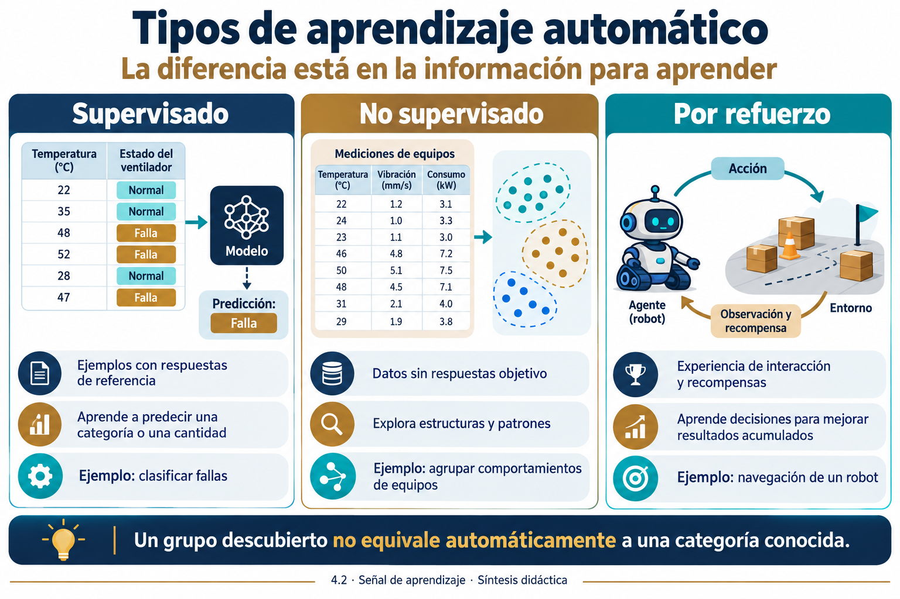
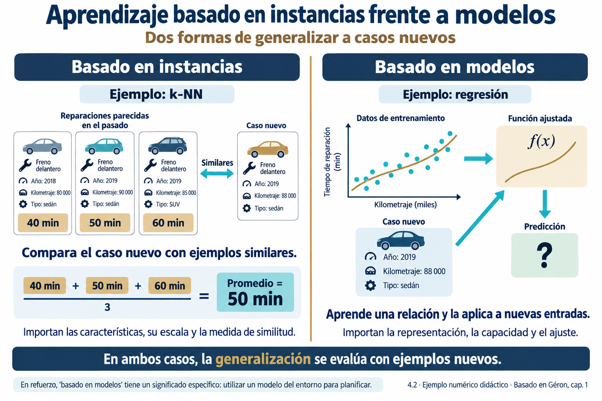

# 4.2 Tipos de aprendizaje: supervisado, no supervisado y por refuerzo

## Propósito

Distinguir los tipos de aprendizaje según la información disponible y el objetivo del sistema. Complementar esta clasificación con la actualización por lotes u online y la generalización basada en instancias o modelos, para formular problemas y justificar alternativas de solución.

## Resultados de aprendizaje

Al concluir, el estudiante podrá:

1. Distinguir clasificación, regresión, exploración de estructuras y decisión secuencial.
2. Justificar cuándo plantear aprendizaje supervisado, no supervisado o por refuerzo.
3. Explicar la diferencia entre actualización por lotes y online.
4. Comparar generalización basada en instancias y basada en modelos.
5. Describir un sistema mediante varios criterios compatibles e identificar retos para evaluarlo.

## Ruta de estudio y fuentes

Recupere la comparación de enfoques de 4.1. Analice después qué información proporciona el problema para aprender, cómo se actualiza el sistema y cómo generaliza. Resuelva los casos y la actividad antes de consultar las respuestas orientadoras.

La fuente principal es Géron [1], capítulo 1, especialmente *Training Supervision*, *Batch Versus Online Learning* e *Instance-Based Versus Model-Based Learning*. Sutton y Barto [2] complementan el aprendizaje por refuerzo. Los ejemplos, tablas numéricas y actividades de este apunte son **elaboraciones didácticas para el curso**, no ejercicios transcritos de los libros.

## 1. Tres criterios para describir un sistema

En 4.1 estudiamos representaciones simbólicas, modelos estadísticos y arquitecturas conexionistas. Ahora cambia la pregunta: ¿qué información recibe el sistema para aprender?

Un conjunto con diagnósticos, una colección sin categorías y un agente que recibe recompensas describen experiencias distintas. Además, debemos decidir cómo incorporar información reciente y qué mecanismo utilizar para responder a ejemplos nuevos. Géron organiza estas distinciones mediante criterios complementarios [1, cap. 1].

| Criterio | Pregunta | Alternativas de este subtema |
|---|---|---|
| Señal de aprendizaje | ¿Qué información orienta el aprendizaje? | Supervisado, no supervisado y por refuerzo; modalidades semisupervisada y autosupervisada. |
| Actualización | ¿Cómo se incorporan nuevos datos al aprendizaje? | Por lotes u online. |
| Generalización | ¿Cómo se utiliza la experiencia ante nuevos casos? | Basada en instancias o basada en modelos. |

Las categorías de una fila no sustituyen a las de otra. Un predictor puede ser supervisado, actualizarse online y estar basado en modelos. Estos criterios tampoco reemplazan los enfoques de 4.1.

## 2. Aprendizaje supervisado

El aprendizaje supervisado utiliza ejemplos que incluyen entradas y una respuesta de referencia. Durante el entrenamiento, el procedimiento ajusta un modelo para relacionarlas y producir respuestas ante entradas nuevas [1, cap. 1].

Podemos representar los datos como pares:

$$
D=\{(x_i,y_i)\}_{i=1}^{n}.
$$

Aquí, $x_i$ describe las características de un ejemplo y $y_i$ su respuesta objetivo. El sistema produce una predicción $\hat{y}_i$, que puede compararse con $y_i$. La notación no exige que las entradas sean numéricas en origen, pero muchos algoritmos requieren convertirlas a una representación numérica.

«Supervisado» no significa que una persona observe cada paso del algoritmo. Las respuestas pueden proceder de diagnósticos expertos, instrumentos, transacciones registradas o acontecimientos observados posteriormente. La calidad de esas referencias condiciona lo que el modelo puede aprender.

### 2.1 Clasificación

En clasificación, la salida corresponde a una categoría. Un sistema puede decidir entre «normal» y «falla» o entre distintos tipos de defecto.

| Modalidad | Característica | Ejemplo |
|---|---|---|
| Binaria | Dos categorías posibles. | Correo legítimo o spam. |
| Multiclase | Una categoría entre varias alternativas. | Tipo principal de falla de un equipo. |
| Multietiqueta | Varias etiquetas pueden corresponder al mismo ejemplo. | Documento que aborda simultáneamente IA y educación. |

Una categoría puede codificarse con números. Usar 0, 1 y 2 para representar tipos de falla no transforma la tarea en regresión: importa el significado de la salida.

La regresión logística, pese a su nombre, se utiliza habitualmente en clasificación. Otros ejemplos son Naive Bayes, árboles, SVM y MLP. El entrenamiento de estos modelos se desarrollará en 4.3 y 4.4.

### 2.2 Regresión

En regresión, el objetivo es predecir una cantidad numérica, como consumo energético, producción o tiempo de respuesta.

| Aplicación | Entradas posibles | Objetivo |
|---|---|---|
| Consumo de un edificio | Horario, ocupación y temperatura. | Energía consumida en kWh. |
| Producción de una huerta | Clima, riego y características del suelo. | Producción en kilogramos. |
| Rendimiento de un servicio web | Carga y recursos disponibles. | Latencia en milisegundos. |

La regresión lineal es un ejemplo sencillo, pero también existen árboles, redes neuronales y otros modelos de regresión. El tipo de tarea no determina un algoritmo único.

### 2.3 Ejemplo resuelto

Un registro de mantenimiento contiene temperatura, carga de procesamiento, velocidad del ventilador y diagnóstico. Si la pregunta es «¿qué condición presenta el equipo?», y el diagnóstico está disponible para entrenar, planteamos clasificación supervisada.

Si la pregunta cambia a «¿cuántos minutos faltan para superar un límite térmico?», necesitamos un objetivo numérico y registros que permitan construirlo. El mismo dominio conduce a una tarea diferente y puede requerir otro diseño de datos.

**Comentario del profesor.** Antes de entrenar, compruebe que las variables estarán disponibles cuando deba hacerse la predicción. Un diagnóstico obtenido después de una inspección puede ser la etiqueta, pero no una entrada válida para anticipar esa misma condición.

### 2.4 Evaluación inicial

En clasificación se utilizan exactitud, precisión, sensibilidad y F1, entre otras métricas. En regresión pueden emplearse MAE y RMSE. Su elección depende del costo de los errores y de la distribución de los datos.

La validación permite seleccionar alternativas, mientras que la prueba reservada evalúa el sistema seleccionado. Si las observaciones proceden del mismo equipo o de una secuencia temporal, la partición debe respetar esa estructura. Estas cuestiones se profundizan en 4.5 [1, caps. 2 y 3].

## 3. Aprendizaje no supervisado

El aprendizaje no supervisado busca estructura en datos sin respuestas objetivo proporcionadas para cada ejemplo. La ausencia de etiquetas no elimina el objetivo del análisis: debemos precisar qué estructura buscamos y para qué será útil [1, cap. 1].

### 3.1 Agrupamiento

El agrupamiento o *clustering* reúne ejemplos según un criterio de similitud. Por ejemplo, una plataforma educativa puede explorar patrones de participación utilizando frecuencia de acceso, entregas y tiempo de consulta.

K-means, DBSCAN, clustering jerárquico y mezclas gaussianas representan alternativas con supuestos distintos. El número, forma o pertenencia a los grupos dependen del método y de la representación. Los algoritmos se desarrollarán en la Unidad 6.

Un grupo no posee automáticamente un significado externo. Reunir estudiantes con actividad semejante no demuestra que tengan el mismo nivel de motivación. La interpretación requiere evidencia adicional.

### 3.2 Reducción de dimensionalidad

La reducción de dimensionalidad obtiene una representación con menos dimensiones. Puede facilitar visualización, compresión o análisis de variables correlacionadas.

PCA construye componentes que capturan varianza bajo sus restricciones matemáticas. Capturar mucha varianza no garantiza conservar la información más útil para una etiqueta futura. Además, PCA no forma grupos por sí mismo [1, cap. 8].

### 3.3 Detección de anomalías

Una anomalía es una observación que se aparta del comportamiento de referencia según un método. Una medición inusual puede indicar una falla, un error de sensor o una condición legítima poco frecuente.

La detección de anomalías admite distintos planteamientos. Algunos no requieren etiquetas; otros aprenden con ejemplos normales o utilizan ejemplos etiquetados de anomalías. Por ello, no toda detección de anomalías es necesariamente no supervisada [1, caps. 1 y 9].

### 3.4 Ejemplo resuelto

Tenemos grabaciones acústicas de colmenas sin etiquetas biológicas verificadas. Podemos extraer características y explorar grupos de sonidos similares. Es un planteamiento no supervisado de agrupamiento.

Sin embargo, esos grupos podrían reflejar micrófonos, ubicaciones o ruido ambiental. No podemos llamarlos «colmenas sanas» y «colmenas enfermas» únicamente porque el algoritmo produjo dos grupos. Para esa interpretación necesitamos evidencia de campo y una definición verificable de la condición.

### 3.5 Evaluación

Podemos estudiar cohesión y separación, estabilidad ante cambios y utilidad para el objetivo. Las métricas internas no sustituyen la revisión del dominio. Un agrupamiento matemáticamente bien separado puede corresponder a una variable irrelevante, como el dispositivo utilizado.

**Comentario del profesor.** No disponer de etiquetas no obliga a sustituir una tarea predictiva por agrupamiento. Si la decisión exige identificar una condición concreta, quizá debamos recopilar las respuestas de referencia que faltan.

## 4. Aprendizaje por refuerzo

En aprendizaje por refuerzo, un agente aprende a tomar decisiones mediante experiencia de interacción. Recibe recompensas y busca una política que favorezca buenos resultados acumulados. Las decisiones pueden modificar las situaciones futuras, por lo que importa la secuencia de acciones [1, cap. 1; 2, cap. 1].

### 4.1 Elementos

| Elemento | Significado | Ejemplo en un robot móvil |
|---|---|---|
| Agente | Quien selecciona acciones. | Controlador del robot. |
| Entorno | Sistema donde ocurren las acciones. | Espacio de navegación. |
| Estado | Descripción relevante de la situación. | Configuración del robot y su entorno. |
| Observación | Información que el agente recibe. | Lecturas de sensores. |
| Acción | Decisión ejecutable. | Avanzar o girar. |
| Recompensa | Señal numérica asociada a la experiencia. | Valor positivo al llegar y negativo al chocar. |
| Política | Mecanismo que selecciona acciones. | Elegir un movimiento a partir de la información disponible. |

Estado y observación no siempre coinciden. Los sensores pueden proporcionar una vista incompleta del entorno. Asimismo, la recompensa no suele indicar qué acción concreta habría sido la correcta en cada paso.

### 4.2 Interacción y consecuencias futuras

El agente recibe información, selecciona una acción y observa una nueva situación y una recompensa. El algoritmo utiliza las experiencias para mejorar su comportamiento. Algunas consecuencias aparecen después de varias decisiones, lo que dificulta atribuir el resultado a una acción particular.

Una formulación habitual expresa el retorno como:

$$
G_t=\sum_{k=0}^{\infty}\gamma^k r_{t+k+1}.
$$

$r_{t+k+1}$ representa una recompensa futura y $\gamma$ es el factor de descuento. En tareas continuas suele utilizarse $0\leq\gamma<1$; también existen formulaciones episódicas sin descuento. El punto conceptual es valorar las consecuencias acumuladas, no solo el beneficio inmediato [2].

### 4.3 Exploración y explotación

Explorar consiste en probar acciones para obtener información. Explotar consiste en utilizar lo aprendido para elegir acciones que parecen convenientes. Un agente que explora poco puede conservar una estrategia mediocre; uno que explora sin aprovechar lo aprendido puede desperdiciar recursos.

La experiencia también puede proceder de registros previos de interacción. Aprendizaje por refuerzo no implica obligatoriamente experimentar en vivo durante cada entrenamiento o después del despliegue.

### 4.4 Ejemplo de riego en simulación

Un agente observa humedad del suelo, pronóstico y restricciones de agua. Puede seleccionar cantidades de riego. Una recompensa representa el cumplimiento de condiciones del cultivo y el costo del agua.

Si solo premiamos humedad alta, podría aprender a regar demasiado. La recompensa, las restricciones y la fidelidad del simulador deben representar el objetivo. Un comportamiento favorable en simulación no demuestra transferencia directa a una huerta real.

Q-learning, SARSA y DQN son ejemplos de algoritmos. Su evaluación puede considerar retorno, éxito, incumplimiento de restricciones y variabilidad entre ejecuciones. En esta unidad basta comprender la formulación y sus diferencias con predicción y agrupamiento.

*Figura 1. Tipos de aprendizaje según la información disponible. Elaboración didáctica con apoyo de IA, basada en [1, cap. 1] y [2, cap. 1]. Las mediciones y etiquetas ilustradas son hipotéticas y no representan límites técnicos de operación.*

## 5. Modalidades complementarias

### 5.1 Aprendizaje semisupervisado

Combina pocos ejemplos etiquetados con muchos sin etiqueta. Por ejemplo, un conjunto de grabaciones con algunas condiciones verificadas puede aprovechar información de las grabaciones restantes, si los supuestos del método son adecuados.

No es una solución automática a cualquier falta de etiquetas: una relación incorrecta entre los conjuntos puede introducir errores.

### 5.2 Aprendizaje autosupervisado

Construye objetivos a partir de los propios datos, como reconstruir una parte oculta de una señal o predecir información ausente. Esto permite aprovechar colecciones sin anotación externa.

Géron lo distingue como una modalidad propia porque utiliza objetivos generados, aunque a veces se agrupa dentro del aprendizaje no supervisado [1, cap. 1]. Un autoencoder aprende a reconstruir entradas y suele presentarse en ambas perspectivas. Esta tarea no proporciona automáticamente categorías de salud, fallas u otros significados externos.

## 6. Aprendizaje por lotes frente a online

Esta distinción se refiere a la incorporación de nueva experiencia al entrenamiento [1, cap. 1].

| Aspecto | Por lotes | Online o incremental |
|---|---|---|
| Actualización | Entrena sobre un conjunto disponible y utiliza el modelo resultante. | Actualiza progresivamente con observaciones o pequeños lotes. |
| Nuevos datos | Habitualmente exige un proceso de reentrenamiento del sistema. | Puede incorporarlos sin repetir necesariamente el ajuste sobre todo el historial. |
| Ventaja | Facilita comparar y controlar versiones. | Permite procesar flujos o conjuntos grandes. |
| Dificultad | Puede quedar desactualizado entre reentrenamientos. | Actualizaciones defectuosas pueden degradar lo aprendido. |
| Ejemplo | Actualizar mensualmente un predictor de demanda. | Ajustar un predictor al recibir nuevas mediciones y respuestas reales. |

### 6.1 Distinciones necesarias

**Online no significa conectado a Internet.** Describe actualización incremental y también puede servir para recorrer datos almacenados que no caben en memoria.

**Predecir en tiempo real no equivale a aprender online.** Un servicio puede responder inmediatamente con un modelo fijo. Para aprender necesita una actualización explícita y, en aprendizaje supervisado, acceso a respuestas de referencia.

**Minilotes de optimización y actualización del sistema son niveles distintos.** Una red puede entrenarse sobre un conjunto fijo utilizando minilotes y desplegarse sin aprendizaje incremental.

En refuerzo, «offline» puede referirse específicamente al aprendizaje con un conjunto fijo de experiencias de interacción. Conviene explicitar el contexto del término.

### 6.2 Ejemplo

Una plataforma recibe una medición cada minuto y calcula una predicción. Si conserva los parámetros durante semanas, realiza inferencia continua con un modelo fijo. Si utiliza nuevas observaciones y resultados verificados para ajustar parámetros de manera incremental, incorpora aprendizaje online.

La actualización puede ayudar frente a cambios, pero también introducir olvido de patrones anteriores. Necesita monitoreo y evaluación, igual que el reentrenamiento por lotes.

*Figura 2. Aprendizaje por lotes frente a online. Elaboración didáctica con apoyo de IA, basada en [1, cap. 1]. La frecuencia mensual de actualización es únicamente un ejemplo.*

## 7. Aprendizaje basado en instancias frente a modelos

Géron utiliza esta clasificación para explicar dos formas generales de generalizar a casos nuevos [1, cap. 1].

### 7.1 Basado en instancias

Conserva ejemplos de referencia y utiliza una medida de similitud para responder. k-NN busca vecinos de una nueva entrada y combina sus respuestas.

**Ejemplo didáctico.** Para estimar un tiempo de reparación, se recuperan tres casos similares con duraciones de 40, 50 y 60 minutos. Si utilizamos un promedio simple, la predicción es 50 minutos. La calidad depende de que los casos sean comparables y la distancia represente similitud relevante.

No se reduce a memorizar respuestas exactas. La selección de características, su escala, la distancia y el número de vecinos influyen en la generalización. También puede requerir estructuras de búsqueda y un almacenamiento considerable.

### 7.2 Basado en modelos

Ajusta una representación y la utiliza para responder. En regresión lineal puede ser una función con coeficientes; en un árbol, una estructura de decisiones; en un MLP, una red parametrizada.

Un predictor de tiempo de reparación podría ajustar una función con tipo de equipo, antigüedad y diagnóstico. La predicción se obtiene aplicando esa función a las características del caso nuevo.

| Criterio | Instancias | Modelos |
|---|---|---|
| Referencia principal al predecir | Casos similares almacenados. | Representación ajustada. |
| Ejemplo característico | k-NN. | Regresión logística, árbol o MLP. |
| Decisión relevante | Similitud y selección de vecinos. | Familia, estructura y ajuste del modelo. |
| Costo | Puede aumentar al consultar muchos ejemplos. | Depende de la estructura y del entrenamiento. |

La distinción es orientadora: algunos métodos retienen ejemplos y ajustan componentes simultáneamente. «Basado en modelos» tampoco equivale a «estadístico» como categoría excluyente de 4.1.

En aprendizaje por refuerzo, *model-based* tiene un significado específico: emplear un modelo del entorno para planificar. Debe distinguirse del uso general de este apartado [2].

*Figura 3. Generalización por instancias y por modelos. Elaboración didáctica con apoyo de IA, basada en [1, cap. 1]. Los tiempos y registros de reparación son hipotéticos. La curva es un esquema conceptual, no el resultado de un ajuste experimental; en refuerzo, «basado en modelos» se refiere al uso de un modelo del entorno para planificar [2].*

## 8. Clasificación conjunta de sistemas

| Sistema | Señal de aprendizaje | Actualización descrita | Generalización |
|---|---|---|---|
| Regresión logística con correos etiquetados, entrenada una vez. | Supervisado. | Por lotes. | Basada en modelos. |
| k-NN con una colección fija de diagnósticos. | Supervisado. | Colección fija de referencia. | Basada en instancias. |
| Predictor lineal actualizado con nuevos ejemplos y respuestas. | Supervisado. | Online. | Basada en modelos. |
| K-means sobre un conjunto fijo de clientes. | No supervisado. | Por lotes. | Usa una representación mediante centroides. |
| DQN que actualiza una red con experiencias de interacción. | Por refuerzo. | Incremental durante el aprendizaje descrito. | Usa una red para aproximar valores de acciones. |

La última fila no implica que DQN sea *model-based reinforcement learning*: DQN suele describirse como un método de refuerzo sin modelo de la dinámica del entorno. Aquí se muestra por qué debemos aclarar el sentido de «modelo» en cada contexto.

## 9. Relación con los retos de 4.1

La sección 10 del [apunte 4.1](../4.1-aprendizaje-simbolico-estadistico-conexionista/apuntes.md) desarrolla datos insuficientes, representatividad, calidad, características, sobreajuste, subajuste y discrepancia. En 4.2 importa reconocer cómo afectan a cada planteamiento.

| Planteamiento | Riesgo particular | Comprobación necesaria |
|---|---|---|
| Supervisado | Etiquetas incorrectas o desbalance. | Revisar origen de respuestas y errores por clase. |
| No supervisado | Grupos definidos por ruido o dispositivo. | Examinar estabilidad, variables y significado externo. |
| Por refuerzo | Recompensa que incentiva conductas indeseadas. | Analizar resultados acumulados y restricciones. |
| Online | Datos recientes defectuosos o cambios que desplazan lo aprendido. | Vigilar actualizaciones y desempeño temporal. |
| Instancias | Distancias dominadas por escalas o variables irrelevantes. | Revisar representación y medida de similitud. |

**Comentario del profesor.** Un sistema no se vuelve útil solo por tener más datos o un algoritmo más complejo. Debemos comprobar qué aprende, con qué información y en qué condiciones se evalúa [1, cap. 1].

## 10. Actividad de aprendizaje

### 10.1 Análisis guiado

Para cada caso, identifique tarea, señal de aprendizaje, información necesaria y una forma de evaluación. Cuando el caso no especifique actualización o mecanismo de generalización, indique «no determinado» en vez de inferirlo.

| Caso | Situación |
|---|---|
| A | Predecir producción de guayaba con registros de clima, riego y kilogramos cosechados. |
| B | Agrupar audios sin etiquetas biológicas por sus características acústicas. |
| C | Aprender decisiones de riego en un simulador con recompensas y restricciones. |
| D | Clasificar fallas con k-NN y una colección fija de diagnósticos. |
| E | Actualizar incrementalmente un predictor de consumo con nuevas mediciones y valores reales. |

**Evidencia:** matriz comparativa y una justificación breve del caso con mayor incertidumbre. Se valoran la relación entre objetivo y datos, precisión de las clasificaciones y evaluación pertinente. No se exige implementación.

### 10.2 Trabajo independiente

Recupere el problema profesional definido en 4.1. Indique qué resultado espera, qué etiquetas o recompensas existen y si la tarea exige decisiones secuenciales. Justifique la necesidad o no de actualización incremental y proponga una alternativa por instancias o por modelos cuando corresponda.

**Producto:** una página de formulación, incorporable al planteamiento del experimento de 4.3. Distinga datos disponibles de datos que aún necesita obtener.

## 11. Autoevaluación conceptual

1. ¿Por qué una categoría codificada como 0, 1 o 2 no convierte una clasificación en regresión?
2. ¿Encontrar dos grupos en grabaciones demuestra que existen dos estados de salud?
3. ¿Qué diferencia hay entre recibir una etiqueta correcta y recibir una recompensa?
4. ¿Un sistema que predice cada segundo aprende online necesariamente?
5. ¿Utilizar minilotes implica aprendizaje online en producción?
6. ¿Qué decisiones influyen en la generalización de k-NN?
7. ¿Por qué el objetivo de reconstrucción de un autoencoder puede llamarse autosupervisado?
8. ¿Puede una red neuronal utilizarse tanto con etiquetas como con recompensas?
9. ¿Qué información falta para decidir entre aprendizaje por lotes y online?
10. ¿Por qué no debemos llamar a DQN «refuerzo basado en modelos» solo porque utiliza una red?

Respuestas orientadoras

1. Los números son identificadores de categorías, no cantidades con significado numérico para el objetivo.
2. No. Los grupos pueden reflejar dispositivos, condiciones ambientales u otras diferencias. Hace falta evidencia biológica para esa interpretación.
3. La etiqueta proporciona una respuesta de referencia para un ejemplo. La recompensa evalúa un resultado de interacción y puede no identificar la acción correcta.
4. No. Puede responder continuamente con parámetros fijos.
5. No. Los minilotes pueden utilizarse para optimizar un modelo con un conjunto fijo antes de desplegarlo.
6. Características, escalamiento, medida de similitud, vecinos y representatividad de los casos de referencia.
7. Porque el objetivo se construye a partir de los propios datos, sin una anotación externa para cada entrada.
8. Sí. La arquitectura no determina por sí sola la señal de aprendizaje.
9. Ritmo de cambios, disponibilidad de respuestas, volumen, recursos y requisitos de evaluación y actualización.
10. En refuerzo, «basado en modelos» se refiere al uso de un modelo de la dinámica del entorno para planificar, no a cualquier función parametrizada.

## 12. Aplicaciones y cierre

| Aplicación | Tarea | Planteamiento posible | Reto principal |
|---|---|---|---|
| Filtro de correo | Clasificar mensajes. | Supervisado con Naive Bayes, regresión logística o SVM. | Cambios de vocabulario y distribución de clases. |
| Producción agrícola | Predecir kilogramos. | Regresión supervisada. | Pocos ciclos y condiciones poco representadas. |
| Clientes | Explorar perfiles. | Agrupamiento no supervisado. | Interpretación y selección de variables. |
| Equipos industriales | Detectar comportamientos inusuales. | Detección de anomalías con un referente de operación. | Diferenciar fallas, errores y cambios normales. |
| Audio apícola etiquetado | Identificar una condición definida y verificada. | Clasificación supervisada con características acústicas o redes. | Calidad de etiquetas e independencia entre grabaciones. |
| Audio apícola sin etiquetas | Explorar semejanzas. | Agrupamiento no supervisado. | Evitar atribuir significado sanitario sin evidencia. |
| Riego en simulación | Aprender acciones secuenciales. | Aprendizaje por refuerzo. | Recompensa, restricciones y fidelidad del simulador. |

La formulación del problema determina qué información necesitamos para aprender. Después podemos decidir cómo actualizar el sistema y cómo generalizar. Ninguna de estas clasificaciones garantiza desempeño: la solución debe probarse en condiciones que representen su uso.

## 13. Lecturas y referencias

| Fuente | Apartado | Propósito |
|---|---|---|
| Géron [1] | Capítulo 1, tipos de sistemas, supervisión, lotes/online e instancias/modelos. | Lectura principal del subtema. |
| Géron [1] | Capítulo 1, retos y evaluación. | Conexión con los conceptos de 4.1. |
| Géron [1] | Capítulos 2 y 3. | Consulta sobre formulación y evaluación supervisada. |
| Géron [1] | Capítulos 8 y 9. | Consulta introductoria de reducción y agrupamiento, con desarrollo en la Unidad 6. |
| Sutton y Barto [2] | Capítulo 1. | Agente, recompensa, política y exploración. |

[1] Géron, A. (2022). *Hands-On Machine Learning with Scikit-Learn, Keras, and TensorFlow: Concepts, Tools, and Techniques to Build Intelligent Systems* (3.ª ed.). O’Reilly Media. ISBN 978-1-098-12597-4. Fuente proporcionada por el docente. Lanzamiento de la tercera edición: octubre de 2022; copyright: 2023.

[2] Sutton, R. S., y Barto, A. G. (2018). *Reinforcement Learning: An Introduction* (2.ª ed.). MIT Press. [PDF de consulta alojado en Carnegie Mellon University](https://www.andrew.cmu.edu/course/10-703/textbook/BartoSutton.pdf).

---

**Anterior:** [4.1 Diferencia entre aprendizaje simbólico, estadístico y conexionista](../4.1-aprendizaje-simbolico-estadistico-conexionista/apuntes.md).  
**Siguiente en el curso:** 4.3 Algoritmos clásicos: regresión logística, Naive Bayes y SVM.

