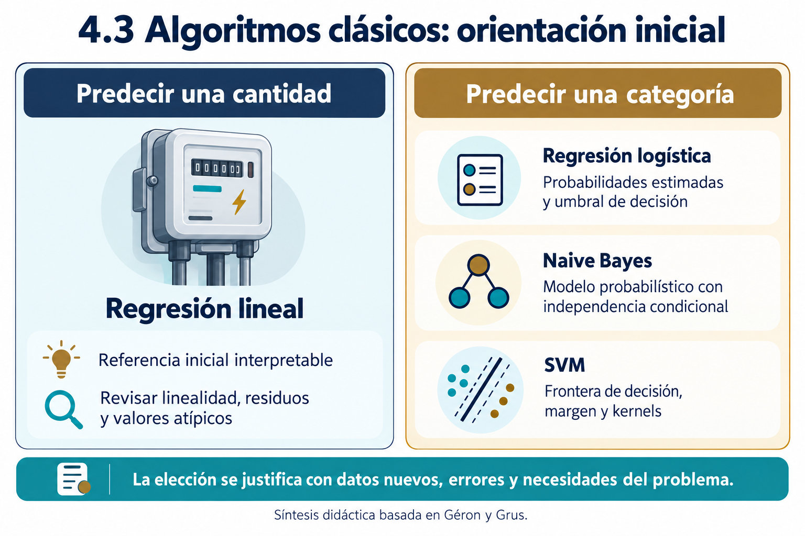
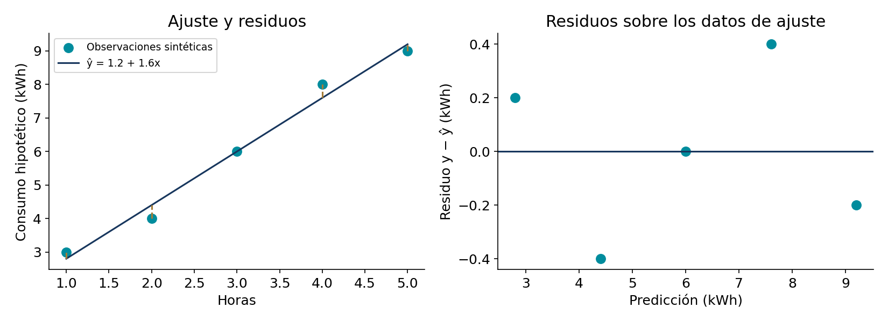
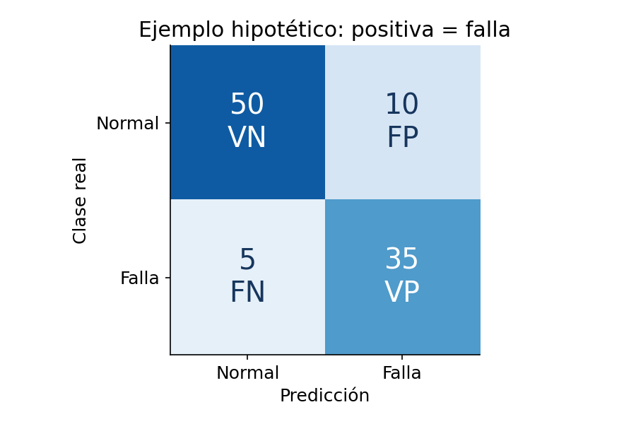
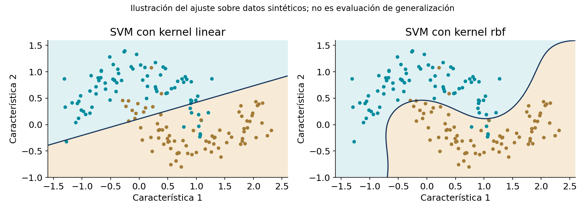

# 4.3 Algoritmos clásicos: regresión y clasificación

## Propósito y resultados de aprendizaje

Comprender, implementar y comparar regresión lineal, regresión logística, Naive Bayes y SVM. Al finalizar, el estudiante podrá formular una tarea supervisada, explicar el funcionamiento esencial de estos algoritmos, reconocer sus ventajas y límites, calcular métricas e interpretar resultados con datos nuevos.

La regresión lineal se incorpora como base para los algoritmos del temario oficial. La regresión múltiple se presenta como extensión breve. El MLP corresponde a 4.4; validación cruzada y selección sistemática de hiperparámetros se profundizarán en 4.5.

## Ruta de estudio y procedencia

1. Lea los apartados 1–4 y resuelva E1–E4 del [cuaderno de ejercicios](ejercicios/ejercicios.md).
2. Ejecute la [práctica 1](notebooks/01-regresion-lineal.ipynb).
3. Estudie métricas de clasificación y regresión logística, resuelva E5–E7 y ejecute la [práctica 2](notebooks/02-regresion-logistica.ipynb).
4. Estudie Naive Bayes y SVM, resuelva E8–E10 y ejecute la [práctica 3](notebooks/03-naive-bayes-svm.ipynb).
5. Resuelva E11–E12 y complete la [práctica comparativa](notebooks/04-comparacion-experimental.ipynb).

Géron [1] es la fuente principal. Grus [2] apoya la comprensión desde cero y Naive Bayes. El Cookbook de Gallatin y Albon [3] apoya la preparación de datos: **la copia adjunta es Early Release y contiene capítulos 1–10**, no los capítulos de entrenamiento de estos algoritmos. Las API y métricas se contrastan con documentación oficial [4–7].

Los ejemplos numéricos, consignas y conjuntos sintéticos son **elaboración didáctica para el curso**, apoyada en estos conceptos. No se presentan como ejercicios extraídos de los libros. Wine es un conjunto real de terceros con procedencia documentada en [datos/README.md](datos/README.md).

## 1. El problema antes del algoritmo

Una tarea de regresión predice una cantidad; una de clasificación predice una categoría. Por ejemplo, estimar consumo en kWh es regresión y distinguir normal/falla es clasificación. Si una categoría usa el código 0 o 1 sigue siendo una categoría.

Debemos identificar las características $X$, el objetivo $y$, la unidad de observación y el momento en que se predice. Una entrada solo es válida si estará disponible en ese momento. El resultado posterior de una inspección puede servir como etiqueta, pero utilizarlo para anticipar ese diagnóstico introduciría fuga de información [1, cap. 2].

| Algoritmo | Cuándo considerarlo | Ventajas | Limitaciones que deben revisarse |
|---|---|---|---|
| Regresión lineal | Predecir cantidades cuando una relación lineal en parámetros es una referencia razonable. | Sencilla, eficiente e interpretable. | Relaciones omitidas, extrapolación y sensibilidad a observaciones influyentes. |
| Regresión logística | Clasificar y obtener probabilidades estimadas. | Eficiente, regularizable y explicable mediante coeficientes con contexto. | Frontera lineal en las características utilizadas; calibración no garantizada. |
| Naive Bayes | Clasificación con una variante compatible con la representación, incluyendo texto. | Rápido, sencillo y útil como referencia. | Independencia condicional y supuestos de distribución; probabilidades a veces mal calibradas. |
| SVM | Clasificación con margen y posibles relaciones no lineales. | Flexible mediante kernels y regularización. | Sensible a escalas, ajuste de hiperparámetros y costo de kernels en conjuntos grandes. |

*Figura 1. Orientación inicial. Elaboración didáctica con apoyo de IA, basada en [1] y [2]. No constituye una regla de superioridad de un algoritmo.*

## 2. Un protocolo común de trabajo

Separamos datos de entrenamiento, validación y prueba reservada. Ajustamos preprocesamiento y modelos con entrenamiento; comparamos alternativas en validación y consultamos prueba después de seleccionar. Una transformación como escalamiento o imputación debe aprenderse sin utilizar validación ni prueba. Un `Pipeline` ayuda a conservar esa relación [1, cap. 2; 6].

En datos temporales, por equipos o por sujetos, una partición aleatoria puede mezclar información dependiente. La partición debe representar la futura aplicación. Las prácticas utilizan ejemplos independientes con una partición fija para facilitar la introducción.

*Figura 2. Protocolo utilizado en las prácticas. Elaboración didáctica con apoyo de IA, basada en [1]. La selección sistemática se desarrollará en 4.5.*

Una referencia sencilla permite evaluar si el esfuerzo aporta valor. Para regresión utilizaremos la media aprendida en entrenamiento; para clasificación, la clase más frecuente. El valor de estas referencias depende de la métrica y del problema.

## 3. Regresión lineal simple

### 3.1 Intuición y formulación

Buscamos una recta que relacione una entrada numérica con la respuesta:

$$
\hat y=a+bx.
$$

$a$ es el intercepto y $b$ la pendiente. Un residuo sobre los datos ajustados es $e_i=y_i-\hat y_i$. Mínimos cuadrados elige los coeficientes que minimizan la suma de residuos al cuadrado [1, cap. 4; 2, cap. 14].

Si existe variación en $x$, la solución con intercepto es:

$$
b=\frac{\sum_i(x_i-\bar x)(y_i-\bar y)}{\sum_i(x_i-\bar x)^2},\qquad a=\bar y-b\bar x.
$$

Minimizar la suma o el promedio de cuadrados produce el mismo minimizador en este caso. No se deben sustituir sin justificación todos los residuos por errores absolutos: sería otro criterio de ajuste.

### 3.2 Ejemplo manual resuelto

Consideremos cinco observaciones sintéticas de horas de operación y consumo hipotético:

| Horas $x$ | Consumo $y$ (kWh) | Predicción $\hat y$ | Residuo $y-\hat y$ |
|---:|---:|---:|---:|
| 1 | 3 | 2.8 | 0.2 |
| 2 | 4 | 4.4 | −0.4 |
| 3 | 6 | 6.0 | 0.0 |
| 4 | 8 | 7.6 | 0.4 |
| 5 | 9 | 9.2 | −0.2 |

Las medias son $\bar x=3$ y $\bar y=6$. El numerador de la pendiente es 16 y el denominador 10, por lo que $b=1.6$ y $a=1.2$.

La predicción para cuatro horas es $1.2+1.6(4)=7.6$ kWh. La pendiente expresa un aumento de 1.6 kWh por hora dentro de esta relación ajustada. El intercepto en cero horas es una extensión de la recta: no demuestra consumo físico real porque cero queda fuera del intervalo observado.

*Figura 3. Gráfica calculada con los datos del ejemplo, no generada mediante IA. La recta y sus residuos pertenecen al ajuste de los cinco puntos; no son evidencia de generalización.*

### 3.3 Ventajas, condiciones y límites

La regresión lineal es una referencia útil cuando se necesita interpretación y costo bajo. No requiere que los datos de entrada sigan una distribución normal para calcular la solución. Los supuestos adicionales de inferencia estadística no deben confundirse con requisitos para ejecutar el algoritmo.

Para interpretar coeficientes y realizar inferencia es importante revisar relación funcional, dependencia, varianza del error y otras condiciones. Observaciones influyentes pueden desplazar la recta. Una tendencia aprendida tampoco demuestra causalidad ni permite extrapolar arbitrariamente [2, caps. 14–15].

**Ejercicios vinculados:** E1, E2 y E3. **Práctica:** P1, partes 1–2.

## 4. Regresión múltiple y preparación

La extensión incorpora varias características:

$$
\hat y=b_0+b_1x_1+\cdots+b_px_p.
$$

Un coeficiente representa el cambio de predicción ante una unidad de esa variable manteniendo las demás constantes, según la parametrización del modelo. Con variables relacionadas, los coeficientes pueden ser inestables. No se comparan magnitudes sin considerar unidades, codificación e interacciones [1, cap. 4; 2, cap. 15].

Las variables categóricas deben representarse apropiadamente. Codificar tipos de equipo como 1, 2 y 3 podría introducir un orden y distancias que no tienen sentido. Una codificación indicadora es una alternativa habitual. Los valores faltantes requieren análisis y, cuando corresponde, imputación aprendida solo con entrenamiento [3, caps. 3–5].

### 4.1 Caso de la práctica

El CSV sintético contiene horas, carga y temperatura como entradas y consumo como objetivo. La columna `particion` es metadato experimental y **no se utiliza como característica**. La comparación conserva entrenamiento y validación para los tres modelos.

| Modelo | MAE de validación (kWh) | RMSE (kWh) | R² |
|---|---:|---:|---:|
| Media de entrenamiento | 4.0460 | 4.7545 | −0.0170 |
| Lineal simple | 1.2259 | 1.4841 | 0.9009 |
| Lineal múltiple | 0.9041 | 1.1246 | 0.9431 |

Son resultados calculados al ejecutar P1 con la semilla y el entorno documentados. El modelo múltiple tiene menor error de validación en **este experimento sintético**, no en cualquier problema. La relación generadora incluye las tres variables, por lo que este diseño favorece su utilidad. Valores pueden cambiar ligeramente con versiones numéricas.

Agregar características puede empeorar el desempeño si introducen ruido o complejidad. En P1 se altera una etiqueta de entrenamiento para observar sensibilidad; no se modifica validación ni se consulta prueba.

**Ejercicio:** E4. **Extensión:** añadir una característica aleatoria y documentar si aporta información.

## 5. Métricas de regresión e interpretación

Sea $n$ el número de ejemplos evaluados y $\bar y$ la media de los valores reales del conjunto evaluado:

$$
MAE=\frac1n\sum_i|y_i-\hat y_i|,\qquad RMSE=\sqrt{\frac1n\sum_i(y_i-\hat y_i)^2}.
$$

$$
R^2=1-\frac{\sum_i(y_i-\hat y_i)^2}{\sum_i(y_i-\bar y)^2}.
$$

MAE y RMSE tienen las unidades del objetivo; no son porcentajes por defecto. RMSE asigna más influencia a errores grandes. Compararlos ayuda a describir errores, pero no sustituye examinar su distribución [1, cap. 2; 4].

| Métrica | Lectura correcta | Precaución |
|---|---|---|
| MAE = 0.9 kWh | La diferencia absoluta promedia 0.9 kWh en los casos evaluados. | No implica que todo error sea menor que 0.9. |
| RMSE mayor que MAE | Los cuadrados dan peso adicional a errores grandes. | Una diferencia no prueba por sí sola una causa o cantidad de atípicos. |
| R² = 0.80 | El error cuadrático es 80 % menor que el de predecir la media del propio conjunto evaluado. | No significa 80 % de exactitud ni causalidad. |
| R² negativo | El error cuadrático supera a esa referencia matemática. | No debe interpretarse como imposibilidad de usar los datos. |

Cuando el objetivo es constante, el denominador de R² es cero y el caso requiere tratamiento específico. El R² de prueba puede ser negativo. La media de evaluación usada en su definición no debe confundirse con el predictor desplegable que aprende la media de entrenamiento.

En el ejemplo manual: SSE = 0.4, MAE = 0.24 kWh, RMSE ≈ 0.2828 kWh y R² ≈ 0.9846. Son **métricas sobre ajuste**, no sobre datos nuevos.

## 6. Clasificación y matriz de confusión

Antes de calcular métricas debemos declarar la clase positiva. En el siguiente ejemplo es «falla». Las filas representan la realidad y las columnas la predicción.

| Real / predicción | Normal | Falla |
|---|---:|---:|
| Normal | VN = 50 | FP = 10 |
| Falla | FN = 5 | VP = 35 |

*Figura 4. Ejemplo numérico hipotético, calculado para enseñar métricas. Positiva = falla. No procede de mediciones reales ni de los resultados de Wine.*

$$
Exactitud=\frac{VP+VN}{VP+VN+FP+FN},\quad
Precisión=\frac{VP}{VP+FP},\quad
Sensibilidad=\frac{VP}{VP+FN}.
$$

$$
Especificidad=\frac{VN}{VN+FP},\qquad
F1=\frac{2VP}{2VP+FP+FN}.
$$

| Métrica del ejemplo | Resultado | Interpretación |
|---|---:|---|
| Exactitud | 85 % | 85 de 100 decisiones son correctas. |
| Precisión positiva | 77.78 % | 35 de 45 alertas corresponden a falla real. |
| Sensibilidad | 87.5 % | Se detectaron 35 de las 40 fallas. |
| Especificidad | 83.33 % | Se reconocieron 50 de 60 casos normales. |
| F1 | 82.35 % | Media armónica de precisión positiva y sensibilidad. |

F1 no incorpora directamente verdaderos negativos ni costos de los errores. La exactitud puede ser engañosa con clases desbalanceadas: si solo 1 % de casos presenta falla, predecir siempre «normal» logra 99 % de exactitud y sensibilidad cero.

En multiclase se calculan métricas por clase mediante una interpretación uno contra el resto. F1 **macro** promedia los F1 de cada clase con igual peso; F1 **ponderado** utiliza la frecuencia de cada clase. No se obtiene F1 macro aplicando automáticamente la fórmula a la precisión y sensibilidad macro. Debe declararse el promedio utilizado. Divisiones con denominador cero necesitan una convención explícita [4].

**Ejercicios:** E5 y E6. **Práctica:** P2, parte 1.

## 7. Regresión logística

### 7.1 Funcionamiento y uso

Para clasificación binaria, el modelo combina entradas y aplica la sigmoide:

$$
z=b+\sum_j w_jx_j,\qquad \hat p=\frac1{1+e^{-z}}.
$$

El entrenamiento ajusta coeficientes minimizando una pérdida logística, habitualmente con regularización. La estimación $\hat p$ se transforma en clase mediante un umbral. En este apunte utilizamos la convención «positiva si $\hat p\geq t$»; en implementaciones deben comprobarse clases y reglas de empate.

Si $z=0.2$, la estimación es aproximadamente 0.5498. Un umbral 0.5 produce positiva y uno 0.6 produce negativa. Cambiar el umbral no requiere volver a aprender coeficientes, pero elegirlo exige validación y considerar consecuencias [1, caps. 3–4; 2, cap. 16].

### 7.2 Ventajas y límites

Es rápida, regularizable y útil como referencia. Con características originales produce una frontera lineal; transformaciones permiten otras fronteras. Los coeficientes describen cambios en log-odds bajo el modelo, no cambios directos constantes de probabilidad.

Escalar suele facilitar regularización y optimización. En scikit-learn, C controla inversamente la intensidad de regularización: menor C implica regularización más fuerte. La probabilidad estimada no garantiza calibración. La elección de solvers y manejo multiclase depende de la implementación.

P2 usa regresión logística multiclase en Wine. La decisión entre tres clases no se explica simplemente con un umbral binario de 0.5. El notebook muestra probabilidades y predicciones, manteniendo la semántica de las etiquetas.

### 7.3 Interpretación de umbrales

Reducir un umbral puede aumentar detecciones y falsas alarmas para puntuaciones fijas; subirlo reduce el conjunto de predicciones positivas. La precisión no necesariamente cambia de forma monótona en una muestra concreta. En ningún caso un umbral elimina la necesidad de medir errores.

**Ejercicio:** E7. **Práctica:** P2. La selección sistemática se desarrolla en 4.5.

## 8. Naive Bayes

### 8.1 Idea y fórmula

El teorema de Bayes relaciona probabilidades previas y evidencia:

$$
P(C\mid x)=\frac{P(x\mid C)P(C)}{P(x)}.
$$

Naive Bayes asume independencia condicional de las características dada la clase, de modo que compara:

$$
P(C)\prod_j P(x_j\mid C).
$$

Para predecir la clase no se necesita el denominador común. Las probabilidades normalizadas sí requieren normalización entre clases. En implementación se utilizan logaritmos para evitar que productos muy pequeños causen problemas numéricos [2, cap. 13; 5].

### 8.2 Ejemplo manual

Supongamos que 40 % de mensajes son spam. Una palabra aparece en 75 % del spam y en 10 % del correo legítimo. Entonces:

$$
P(Spam\mid palabra)=\frac{0.75(0.4)}{0.75(0.4)+0.10(0.6)}=\frac{0.30}{0.36}\approx0.8333.
$$

Son frecuencias hipotéticas. Este ejemplo enseña Bayes con una característica; la aproximación «naive» se vuelve relevante cuando factorizamos varias características. No debemos multiplicar probabilidades de varias palabras sin declarar el supuesto.

### 8.3 Variantes y suavizado

| Variante | Representación habitual | Consideración |
|---|---|---|
| GaussianNB | Características continuas. | Modela cada característica mediante una distribución gaussiana por clase. |
| MultinomialNB | Conteos o características no negativas, frecuentes en texto. | No admite valores negativos; TF-IDF también se usa en la práctica. |
| BernoulliNB | Presencia o ausencia binaria. | Considera también la ausencia de características. |

El suavizado evita probabilidades cero en estimaciones discretas. Para una característica binaria con conteo $k$ en $n$ ejemplos de clase y suavizado de Laplace: $\hat p=(k+1)/(n+2)$. No debe confundirse con la fórmula multinomial, cuyo denominador incorpora conteos totales y tamaño de vocabulario.

GaussianNB es la variante del experimento común de Wine. La extensión de texto utiliza CountVectorizer y MultinomialNB. El vectorizador aprende vocabulario solo del entrenamiento. No deben transferirse automáticamente transformaciones que generen valores negativos a una variante que exige no negatividad.

### 8.4 Ventajas y límites

Tiene ajuste rápido y puede funcionar como referencia aun con independencia imperfecta. Características muy correlacionadas pueden representar varias veces una misma evidencia. Sus probabilidades pueden estar mal calibradas. Un buen clasificador no necesariamente es un buen estimador probabilístico [5].

**Ejercicios:** E8 y E9. **Práctica:** P3, partes 1 y 3.

## 9. Máquinas de vectores de soporte

### 9.1 Margen y decisión

En una SVM lineal binaria se utiliza una función $f(x)=w^Tx+b$. El signo determina el lado de la frontera. Los vectores de soporte influyen en su ubicación. En una formulación de margen suave, el entrenamiento equilibra amplitud del margen y penalizaciones por violaciones [1, cap. 5].

Con etiquetas $y_i\in\{-1,+1\}$, una expresión habitual es:

$$
\min_{w,b,\xi}\frac12\|w\|^2+C\sum_i\xi_i,
\quad y_i(w^Tx_i+b)\geq1-\xi_i,\quad\xi_i\geq0.
$$

Las variables $\xi_i$ permiten violaciones del margen. Mayor C penaliza más esas violaciones; no garantiza automáticamente mejor generalización. Menor C permite más violaciones y favorece regularización más fuerte.

### 9.2 Ejemplo geométrico

Sea $w=(1,0)$ y $b=-2$. La frontera es $x_1=2$. Un punto con $x_1=3$ produce $f=1$ y uno con $x_1=1$ produce $f=-1$. En esta escala canónica, las rectas de margen son $x_1=1$ y $x_1=3$, separadas por $2/\|w\|=2$. El valor de decisión no es una probabilidad.

### 9.3 Kernels y escalamiento

Un kernel permite representar relaciones no lineales mediante productos internos en un espacio transformado sin construirlo explícitamente en ciertos métodos. El kernel RBF usa una noción de cercanía controlada por gamma. Un gamma alto vuelve la influencia más local y puede generar fronteras complejas; su efecto debe analizarse junto con C y el escalamiento.

*Figura 5. Fronteras ajustadas con datos sintéticos. La figura explica geometría y no compara desempeño de generalización. P3 utiliza una partición separada para evaluar el caso de las lunas.*

SVM puede ser útil con muchas características y cantidades manejables de ejemplos. Los métodos con kernels pueden ser costosos con grandes conjuntos. Escalas muy distintas distorsionan distancias y regularización; P3 y P4 utilizan StandardScaler dentro del pipeline.

SVR es una variante para regresión con su propia pérdida y tolerancia. Se menciona para reconocer que SVM no se limita a clasificación, pero no se añade una quinta práctica obligatoria.

**Ejercicio:** E10. **Práctica:** P3, partes 1–2.

## 10. Comparación experimental en Wine

Wine contiene 178 análisis químicos, 13 características y tres cultivares. No es una clasificación de calidad del producto ni de salud. El archivo conserva aproximadamente 60/20/20 para entrenamiento, validación y prueba con estratificación: 106/36/36 ejemplos. La columna `particion` y la etiqueta `clase` se excluyen de las entradas [7].

P4 compara logística, GaussianNB y SVM RBF con las mismas particiones y escalamiento aprendido dentro de cada pipeline. Configuraciones fijadas antes de prueba: logística C=1; GaussianNB con valores por defecto; SVC RBF C=1, gamma='scale'. El criterio es F1 macro de validación y los empates se resuelven por el orden declarado.

| Candidato | Exactitud de validación | F1 macro de validación |
|---|---:|---:|
| Regresión logística | 0.9722 | 0.9740 |
| GaussianNB | 0.9444 | 0.9475 |
| SVM RBF | 0.9444 | 0.9457 |

En la ejecución incluida se seleccionó logística. Tras reajustar su pipeline con entrenamiento y validación, la prueba reservada obtuvo exactitud 0.9444 y F1 macro 0.9441. La referencia de clase mayoritaria obtuvo F1 macro 0.1867. Dos ejemplos de la clase 1 se asignaron a la clase 2. Los notebooks incluyen salidas y versiones.

Este resultado describe una partición pequeña y configuraciones concretas. No permite declarar superioridad general de logística ni trasladar cifras a equipos industriales o colmenas. Cambiar hiperparámetros después de conocer prueba requiere reconocer un nuevo proceso de desarrollo y una evaluación independiente.

La prueba ya se consultó al producir este paquete como **demostración cerrada**. Si utiliza sus datos para nuevos ajustes, el resultado original deja de ser una prueba independiente de sus decisiones posteriores.

## 11. Ejercicios y prácticas

El [cuaderno de ejercicios](ejercicios/ejercicios.md) contiene doce ejercicios, de formulación y cálculo a auditoría experimental. El [plan de prácticas](practicas/README.md) define evidencias y criterios. Las respuestas se encuentran en [docente/soluciones.md](docente/soluciones.md); conviene reservar esa carpeta para uso del profesor si se publican actividades evaluables.

| Recurso | Recorrido básico | Extensión |
|---|---|---|
| P1 | Regresión simple manual, contraste con biblioteca y múltiple. | Variable irrelevante y dato atípico. |
| P2 | Matriz, umbrales y logística multiclase. | Efecto de C en validación. |
| P3 | GaussianNB y SVM en Wine. | Kernels en lunas y clasificación de texto. |
| P4 | Comparación, selección y evaluación final. | Propuesta de validación cruzada para 4.5. |

No es necesario reimplementar todos los algoritmos para comprenderlos. La implementación desde cero se concentra en mínimos cuadrados y cálculos breves; los modelos de las prácticas usan bibliotecas. Por las nueve horas de la unidad, las extensiones se proponen como trabajo independiente y no como una nueva carga obligatoria de sesión.

## 12. Preguntas de cierre

1. ¿Qué determina la métrica principal: el algoritmo o las consecuencias del error?
2. ¿Por qué un R² alto en entrenamiento no garantiza una predicción útil?
3. ¿Qué cambia al modificar el umbral de logística?
4. ¿Qué distingue independencia condicional de independencia general?
5. ¿Qué papel cumplen escalamiento, C y gamma en una SVM?
6. ¿Qué vuelve injusta una comparación entre modelos?

Al concluir, el estudiante debe poder explicar qué tarea resuelve un algoritmo, qué aprende, qué supuestos introduce, qué errores produce y qué evidencia respalda su elección. Estas preguntas preparan el entrenamiento del MLP de 4.4 y la validación de 4.5.

## 13. Fuentes y lecturas

[1] Géron, A. (2022). *Hands-On Machine Learning with Scikit-Learn, Keras, and TensorFlow* (3.ª ed.). O’Reilly Media. Capítulos 2, 3, 4 y 5. Edición publicada en octubre de 2022, copyright de 2023. Fuente principal proporcionada por el docente.

[2] Grus, J. *Ciencia de datos desde cero: principios básicos con Python* (2.ª ed., traducción proporcionada por el docente). Capítulos 6, 8, 11 y 13–16. La edición original inglesa es *Data Science from Scratch*, 2.ª ed. (2019). No se atribuye a la traducción una fecha editorial no comprobada.

[3] Gallatin, K., y Albon, C. (2023). *Machine Learning with Python Cookbook* (2.ª ed., versión Early Release adjunta). O’Reilly Media. Capítulos 1–10 disponibles; se utilizan principalmente 2–6. Su carácter anticipado requiere revisar las API antes de reutilizar ejemplos.

[4] scikit-learn. [Metrics and scoring](https://scikit-learn.org/stable/modules/model_evaluation.html). Consulta técnica: definiciones, promedios y casos especiales. Las fórmulas y ejemplos se desarrollan aquí de forma didáctica con base principal en [1] y [2].

[5] scikit-learn. [Naive Bayes](https://scikit-learn.org/stable/modules/naive_bayes.html). Consulta de variantes e implementación.

[6] scikit-learn. [Common pitfalls and recommended practices](https://scikit-learn.org/stable/common_pitfalls.html). Consulta de pipelines y fuga de información.

[7] scikit-learn. [Wine dataset](https://scikit-learn.org/stable/modules/generated/sklearn.datasets.load_wine.html). Véase también la descripción y referencias originales incluidas en `datos/wine-descripcion.txt`.

---

**Anterior:** [4.2 Tipos de aprendizaje](../4.2-tipos-de-aprendizaje/apuntes.md).  
**Siguiente:** 4.4 Introducción a redes neuronales y MLP.

